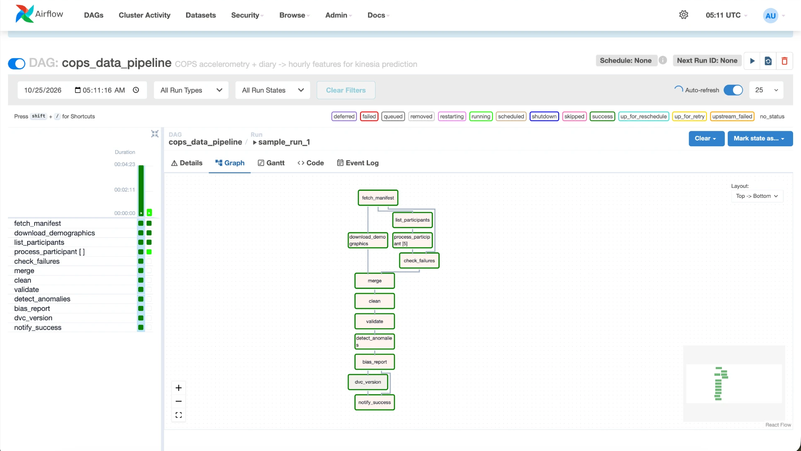
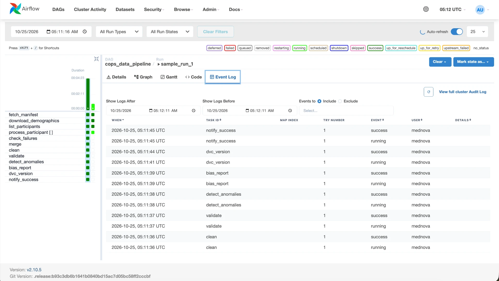
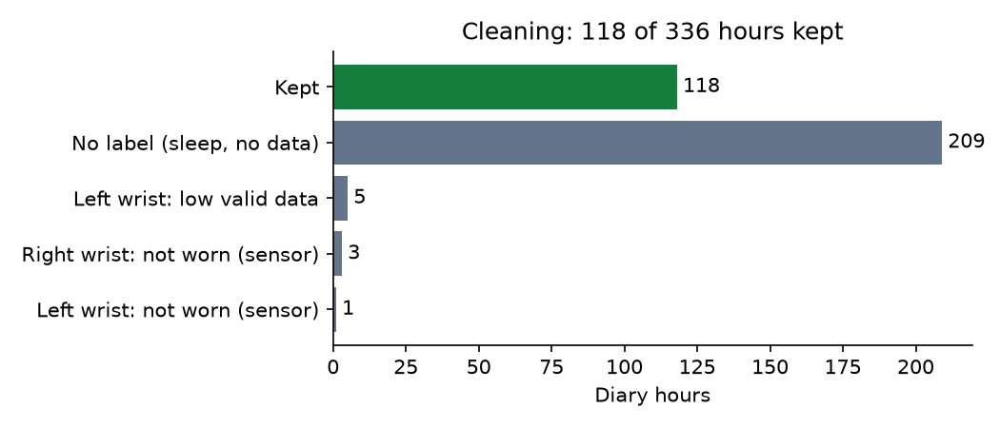
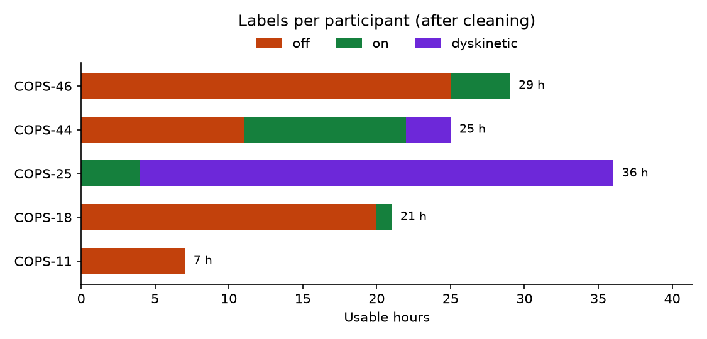
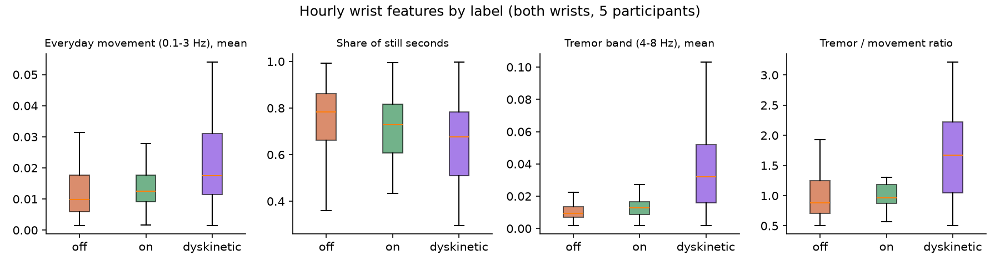
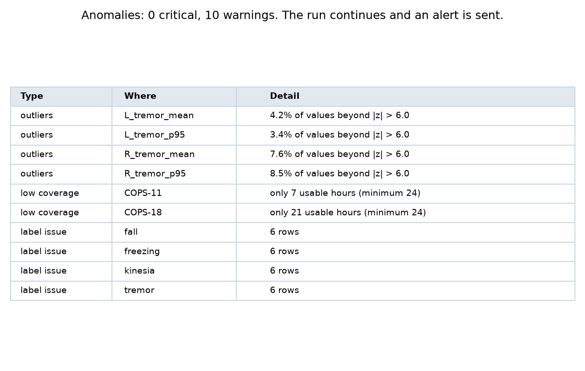
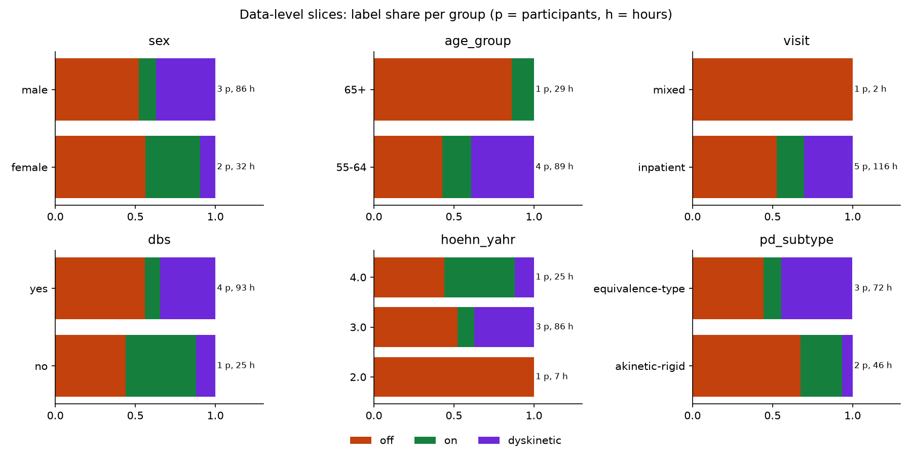
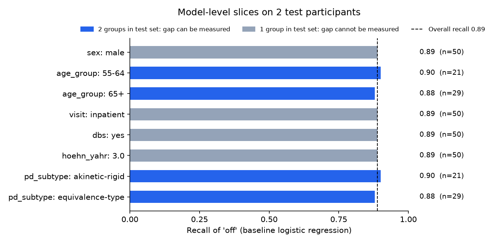
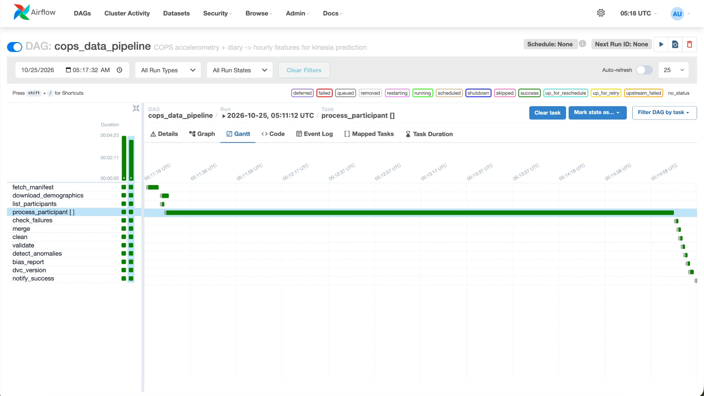

# Data Pipeline

Turns the COPS Parkinson's dataset ([osf.io/5xvwn](https://osf.io/5xvwn/)) into an hourly table of wrist-movement features and symptom labels, ready for modelling.

**Target:** hourly kinesia state from the patient's diary (`KinesiaScore`, −3 to +3):

| KinesiaScore | Class |
| --- | --- |
| −3, −2, −1 | `off` |
| 0 | `on` |
| +1, +2, +3 | `dyskinetic` |

## Dataset

**COPS** ([osf.io/5xvwn](https://osf.io/5xvwn/)), a public dataset of people with Parkinson's disease recorded at home. Check the OSF page for its licence, and cite it as the page asks.

- **66 participants**, one zip each (47.9 GB in all; the 5 smallest, used by `sample` mode, are 1.1 GB).
- **Wrist sensors** on both wrists: one CSV per wrist per hour, 100 samples a second, with acceleration `X`, `Y`, `Z` (in g), `Photo` (light) and `Temp` (temperature). Users are expected to wear one watch, so the pipeline uses one wrist (`features.wrist` in the config, left by default) and ignores the other.
- **An hourly symptom diary** filled in by the participant: kinesia (−3 to +3, the label), tremor, freezing, falls, medication and dose, and whether the watch was worn.
- **Clinical exams:** MDS-UPDRS Part III, OFF and ON medication.
- **`Demographics.csv`:** age, sex, handedness, Parkinson's subtype and dominant side, Hoehn & Yahr stage, years since diagnosis, and DBS.

Participant IDs are the dataset's own pseudonyms (`COPS-7`). Even so, files that list participants are versioned by DVC, not committed (see [Data versioning](#data-versioning-dvc)).

## Quick start (only Docker needed)

Install [Docker Desktop](https://www.docker.com/products/docker-desktop/) and give it at least 4 GB of memory. Then, from this folder:

```bash
mkdir -p logs/airflow && echo "AIRFLOW_UID=$(id -u)" > .env    # Linux only, once, before docker compose
docker compose run --rm tests       # run the tests in the Airflow image (first run builds the image, a few minutes)
docker compose run --rm pipeline    # run the pipeline on the 5 smallest participants (~1.1 GB download)
docker compose up airflow-init      # first time only: sets up Airflow's database and login
docker compose up -d                # starts Airflow at http://localhost:8080 (see Airflow below to run the DAG)
```

Outputs land in `data/` on your machine (see [Output files](#output-files)). Don't run the `pipeline` service and the Airflow DAG at the same time: both write to `data/`. Stop Airflow with `docker compose down`.

**On Linux,** the containers write to this folder as user `AIRFLOW_UID` (50000 by default), which isn't you, so writing to `data/` and `logs/` fails without the first line. It runs the containers as your own user instead. Mac and Windows don't need it. If you copy `.env.example` to `.env` for alerts, set `AIRFLOW_UID` in it to the output of `id -u`.

To work without Docker, set up Python as below.

## Setup

Use **Python 3.11** or 3.12. Python 3.13 and newer fail to install the pinned libraries.

```bash
conda create -n cops python=3.11 -y
conda activate cops
pip install -r requirements.txt
pytest -v
```

All tests should pass. They use small synthetic files, so no download is needed.

If you do not use conda:

```bash
python3.11 -m venv .venv
source .venv/bin/activate
pip install -r requirements.txt
pytest -v
```

## Tests

`docker compose run --rm tests` runs 122 tests in `tests/`, on synthetic participants made by `tests/helpers.py`. Plain `pytest` outside Docker runs 116 of them: the 6 in `test_dag.py` need Airflow and skip. No test downloads anything or sends a real alert.

| File | What it checks |
| --- | --- |
| `test_diary.py` | Diary parsing, kinesia classes, text/score mismatches, every dose-column layout |
| `test_features.py` | Movement and tremor features, gravity removal, missing and impossible values, corrupt files, and the fast CSV reader matching pandas exactly |
| `test_clean_and_join.py` | Every cleaning rule, duplicates, merging participants and demographics |
| `test_validate_and_anomalies.py` | Rules, schema against the baseline, statistics, outliers, label issues |
| `test_acquire_and_bias.py` | Choosing participants from the OSF listing, and the bias report |
| `test_download.py` | Retries after a dropped connection, refusing corrupt or truncated downloads, the download cache, OSF paging and outages, local zips, downloading only `https://` from OSF, and never choosing an odd file name |
| `test_robustness.py` | Diaries in UTF-8, with a BOM or in Windows encoding; wrong separators, empty and cut-off files; partial failures (one participant failing doesn't stop the run, too many do); config files; passwords never logged |
| `test_alerts.py` | Email and Slack alerts when set up, skipped when not, and a broken mail server or webhook never crashing the run |
| `test_run_pipeline.py` | Failed participants reported, the failure limit, parallel runs matching sequential ones |
| `test_end_to_end.py` | The whole pipeline on four synthetic participants: every output, exact row counts, a second run checked against the first, and stopping on too many failures or on critical anomalies |
| `test_dag.py` | The Airflow DAG loads, its tasks run in order, failures retry and alert, and one failed participant doesn't fail the run. Needs Airflow, so it skips outside Docker. `docker compose run --rm tests` runs it; for this file alone, `docker compose run --rm tests python -m pytest tests/test_dag.py` |

Coverage of `scripts/` is about 92%: `pytest --cov=scripts --cov-branch`. CI fails below 85%.

## Running

Run from this folder.

```bash
# Download the 5 smallest participants from OSF and run everything
python -m scripts.run_pipeline --mode sample

# All 66 participants
python -m scripts.run_pipeline --mode full

# Use participant zips you already downloaded
python -m scripts.run_pipeline --local-zips /path/to/folder
```

- Write `scripts.run_pipeline` without `.py`.
- For `--local-zips`, the folder needs the original zips, named like `COPS-7.zip`, plus `Demographics.csv` from the top level of the OSF project.
- Processing one participant takes about half a minute, plus its download (see [Speed](#speed)). Progress is logged every 20 hours.
- Participants run 4 at a time (`run.parallel_participants`), each in its own process. Set it to 1 to run them one after another.
- All settings are in `config/pipeline.yaml`.
- A participant that fails is skipped and listed in `data/reports/failed_participants.json`, and an alert is sent. If more than 20% fail (`data.max_failed_fraction`), the run stops with exit code 1. Airflow follows the same rule, in its `check_failures` task.
- With Docker, the same commands work through the `pipeline` service, e.g. `docker compose run --rm pipeline python -m scripts.run_pipeline --mode full`.

### Airflow

The same steps run as an Airflow DAG in `dags/cops_pipeline_dag.py`. On Linux, run the one-time setup line from [Quick start](#quick-start-only-docker-needed) first. From this folder:

```bash
docker compose up airflow-init   # first time only: sets up the database and the login
docker compose up -d             # starts the webserver and scheduler
```

Open <http://localhost:8080> and log in as `airflow` / `airflow`. Trigger `cops_data_pipeline` with `{"mode": "sample"}` or `{"mode": "full"}`.

A `.env` file is optional. Copy `.env.example` to `.env` only to turn on email or Slack alerts. Without it, alerts are skipped and logged.

To run the DAG:

1. On the DAGs page, set the toggle of `cops_data_pipeline` to on. DAGs are paused when Airflow starts.
2. Click ▶, then **Trigger DAG w/ config**. Type `{"mode": "sample"}` and click **Trigger**.
3. Look at the run in **Grid** (state of each task), **Graph** (how the tasks connect), and **Gantt** (time of each task). To see the output of a task, click the task and then **Logs**.
4. Stop Airflow with `docker compose down`. The run history stays in the Docker volume `data_pipeline_postgres-db`. To delete it, use `docker compose down -v`.

The sign-in and the database are local test values in `docker-compose.yaml`: the `airflow-init` service makes the web user `airflow` with the password `airflow` and the Admin role, and the `postgres` service makes the database user `airflow`.

The DAG has 12 tasks. `process_participant` is mapped: Airflow makes one task for each participant and runs 4 at a time.



In the sample run all 12 tasks passed, including the 5 mapped `process_participant` tasks. The Event Log shows each task go from running to success.



## Results of the sample run

On 2026-10-25 we ran the pipeline on the 5 participants of `sample` mode (COPS-11, 18, 25, 44, 46; 1.08 GB), with Python 3.11. We ran it with `dvc repro` and with the Airflow DAG. Both runs gave the same results.

| Step | Result |
| --- | --- |
| Run time | 2 min 6 s with `dvc repro`. Approximately 4 min with Airflow. 0 participants failed. |
| Cleaning | 118 of 336 hours kept. Removed: 209 without a label, 5 with low valid data, 4 where the sensor showed the watch was not worn. |
| Final dataset | 118 rows, 67 columns. Labels: off 63, dyskinetic 35, on 20. |
| Validation | 0 violations. This run is the schema baseline. |
| Anomalies | 0 critical, 10 warnings: tremor outliers, 2 participants with less than 24 usable hours, and 6 diary rows with a score but no label. An alert was sent. |
| DVC | `dvc.lock` records this version. The data is in the DVC remote. |



The labels depend strongly on the participant:



The tremor features are higher in dyskinetic hours, and the share of still seconds is highest in off hours:





Earlier runs used single participants: COPS-7 (192 diary hours, 105 usable) and COPS-25 (72 diary hours, 36 usable). The reports in Git now come from the 5-participant run.

## Preprocessing steps

1. **Acquire:** list files on OSF, pick participants, and for each one download its zip (checked against OSF's SHA-256, with retries), process it, and delete it. Several participants run at once.
2. **Parse the diary:** read the hourly diary, map `KinesiaScore` to off / on / dyskinetic, and flag rows where the text and score disagree (the text is trusted).
3. **Extract features** for each hour from the wrist set in `features.wrist`:
    1. Magnitude per row: √(X² + Y² + Z²)
    2. Band-pass filter into 0.1–3 Hz (movement, also removes gravity) and 4–8 Hz (tremor)
    3. Absolute value, averaged per second
    4. Hourly summary: `move_mean`, `move_std`, `move_p95`, `still_fraction`, `tremor_mean`, `tremor_p95`, `tremor_ratio`
4. **Name the features:** prefix them with `W_` (the watch), whichever wrist it is, so the column names don't depend on the side.
5. **Add patient info:** UPDRS-III off and on scores, levodopa response, demographics, and hours since the last dose.
6. **Clean:** remove hours with no label (sleep, no data), not worn, missing or low-quality sensor data, and duplicates.
7. **Validate:** check fixed rules, compare with the baseline schema, and save statistics.
8. **Detect anomalies:** missing values, outliers, low coverage, and label issues. Alerts are sent by email or Slack if set up in `.env`.
9. **Bias report:** compare label balance and a baseline model's results across sex, age group, visit, DBS, Hoehn & Yahr, and PD subtype.

**Why we use our own checks for step 7.** TFDV needs TensorFlow. Great Expectations needs a large setup for one table. Our checks in `scripts/validate.py` do the same 3 tasks with pandas: fixed expectations, a schema baseline that we compare with each run, and statistics with a history file. The checks run the same in Airflow and on the command line. Unit tests check them.

## Output files

All in `data/`.

| File | Contents |
| --- | --- |
| `processed/hourly_features.csv` | **Final dataset for modelling:** one row per usable participant-hour |
| `processed/hourly_all.csv` | All diary hours before cleaning |
| `processed/label_issues.json` | Diary text/score mismatches and missing UPDRS files |
| `interim/COPS-X_hourly.csv` | Per-participant table before merging |
| `interim/COPS-X_issues.json` | That participant's diary issues, merged into `processed/label_issues.json` |
| `reports/failed_participants.json` | Participants that could not be processed, with the error (empty means none) |
| `reports/cleaning_summary.json` | Hours kept and removed, by reason |
| `reports/schema_baseline.json` | Reference schema from the first run |
| `reports/schema_latest.json` | Schema of the latest run |
| `reports/validation_report.json` | Failed checks (empty means all passed) |
| `reports/stats/stats_<run>.json` | Full statistics of each run |
| `reports/stats_history.csv` | One summary line per run |
| `reports/anomalies.json` | Critical anomalies and warnings |
| `reports/bias_report.md` | Bias slicing results, to read |
| `reports/bias_report.json` | The same, as data, with the participants the model was tested on |
| `raw/Demographics.csv` | Demographics, downloaded from OSF |
| `raw/manifest.json` | Files used in the run |

Only `cleaning_summary.json` and `bias_report.md` are committed to Git; DVC versions the rest of `processed/` and `reports/`. Raw and interim data aren't versioned.

## Data card

`processed/hourly_features.csv`: one row per participant-hour that has a label and usable sensor data from the watch wrist.

| Group | Columns | What they are |
| --- | --- | --- |
| Identifiers | `participant_id`, `visit`, `day`, `hour_start`, `hour_index` | Who and when: the diary day, the hour it starts (0–23), and hours since the first diary day (`day × 24 + hour_start`) |
| **Label** | `kinesia_class` | `off`, `on` or `dyskinetic`, from `kinesia_score` |
| Diary | `kinesia_text`, `kinesia_score`, `tremor_score`, `tremor_present`, `freezing`, `fall`, `wear_status` | The participant's own hourly entries; `kinesia_score` runs from −3 to +3 |
| Medication | `medication_taken`, `medication`, `dosage_mg`, `hours_since_dose` | Doses logged in the diary, and hours since the last one |
| Movement (`W_`) | `move_mean`, `move_std`, `move_p95`, `still_fraction` | Everyday movement (0.1–3 Hz), from the per-second averages over the hour |
| Tremor (`W_`) | `tremor_mean`, `tremor_p95`, `tremor_ratio` | Tremor-band movement (4–8 Hz), and its size relative to everyday movement |
| Quality (`W_`) | `n_samples`, `valid_fraction`, `n_gaps`, `n_clipped`, `temp_mean`, `photo_mean`, `status` | How much usable data the hour had, gaps and clipped values, and the sensor's temperature and light |
| Clinical | `updrs_off_total`, `updrs_on_total`, `levodopa_response`, `updrs_days_since_exam`, `has_updrs_off`, `has_updrs_on` | MDS-UPDRS Part III OFF and ON; `levodopa_response` is (OFF − ON) / OFF |
| Demographics | `age`, `age_group`, `sex`, `handedness`, `pd_subtype`, `pd_dominantside`, `hoehn_yahr`, `pd_yearssincediagnosis`, `dbs` | From `Demographics.csv`; `age_group` is `<55`, `55-64` or `65+`. Also the slices for the bias report. |
| Files | `left_zip`, `left_csv` (`right_zip`, `right_csv` with `wrist: right`) | The sensor files each row was computed from, for tracing |

## Bias detection and mitigation

**What we checked.** We used 6 slices: sex, age group, visit, DBS, Hoehn and Yahr stage, and Parkinson's subtype.

- Data level: the number of rows and participants, and the label balance, for each group.
- Model level: a baseline logistic regression that predicts "off" or "not off". The training participants and the test participants are different (`GroupShuffleSplit`). For each group we calculate recall, precision, and false positive rate with Fairlearn's `MetricFrame`.

**What we found in the sample run.** The test set has 2 participants and 50 hours.

- Overall recall is 0.889. Precision is 0.909. The false positive rate is 0.8. 90% of the test hours are "off", so the baseline almost always predicts "off". We use this model only to find bias. It is not our final model.
- 2 slices have 2 groups in the test set. Age group: 55-64 has recall 0.90 and 65+ has 0.88. Subtype: akinetic-rigid has 0.90 and equivalence-type has 0.88. The gap is 0.02. Our limit is 0.10 (`bias.max_recall_gap`).
- 4 slices have only 1 group in the test set. Both test participants are male, inpatient, have DBS, and have Hoehn and Yahr stage 3. Thus we cannot measure a gap for these slices. The report shows `nan` for them.
- Data level: some groups have only 1 participant (65+, no DBS, Hoehn and Yahr 2 and 4). The labels depend strongly on the participant. One participant is 89% dyskinetic. Another is 100% off.





**Mitigation.** If a recall gap is more than 0.10, `bias.py` trains the model again with sample weights. These weights give each group the same total weight. The report then shows the recall before and after. The unit tests check this step. In the sample run no gap was more than 0.10, so this step did not start.

**Limits and next steps.** 5 participants are not sufficient to say if the data is fair. In the model phase we will:

1. Use more participants.
2. Use leave-one-participant-out, so that each participant and each group is tested one time.
3. Compare the recall of each group before and after we change the weights.

We expect this trade-off: the new weights can decrease the overall recall a little, but they make the gap between the groups smaller.

## Code structure

```text
Data_Pipeline/
├── config/pipeline.yaml   every setting: paths, download, features, cleaning, validation, alerts, bias
├── dags/                  cops_pipeline_dag.py: the Airflow DAG
├── scripts/               the pipeline, one module per step
│   ├── acquire.py         list OSF files, choose participants, download with retries and checksums
│   ├── diary.py           read the hourly diary, map kinesia to classes, flag text/score mismatches
│   ├── features.py        read the wrist CSVs, filter, and compute the hourly features for one wrist
│   ├── patient_info.py    UPDRS exams and levodopa response
│   ├── process_patient.py one participant zip -> one hourly table (the unit of parallel work)
│   ├── join.py            merge participants and demographics
│   ├── clean.py           drop unusable hours, with a count for each reason
│   ├── validate.py        rules, schema against the baseline, statistics and their history
│   ├── anomalies.py       missing values, outliers, low coverage, label issues
│   ├── bias.py            data slicing and the baseline model's results per slice, with reweighting
│   ├── alerts.py          email and Slack alerts
│   ├── pipeline_steps.py  each step as a function, shared by the DAG and the command line
│   ├── run_pipeline.py    the whole pipeline without Airflow (also what dvc repro runs)
│   └── utils/             config loading, file reading and writing, logging
├── tests/                 pytest tests on small synthetic files (no download)
├── data/                  raw/, interim/, processed/, reports/ (see Output files)
├── docs/                  DAG screenshots, gantt/ (Airflow Gantt charts), charts/ (results of the sample run)
├── logs/                  pipeline.log
├── dvc.yaml               the DVC stage
├── Dockerfile, docker-compose.yaml   Airflow, plus the tests and pipeline services
└── requirements.txt
```

## Data versioning (DVC)

The pipeline is one DVC stage, `build_dataset` in `dvc.yaml`: its inputs are `scripts/` and `config/pipeline.yaml`, and its outputs are everything it writes to `processed/` and `reports/` (listed in `dvc.yaml`). `raw/` and `interim/` are working files and aren't versioned. DVC is set up in this folder (`dvc init --subdir`, so `.dvc/` is here and not at the repo root).

**What goes where:**

| Where | What |
| --- | --- |
| Git | The code, `dvc.yaml`, and `dvc.lock`, which records the hash of every input and output for each version |
| Git, readable by anyone | The summary reports with no participant IDs: `cleaning_summary.json` and `bias_report.md` (`cache: false` in `dvc.yaml`) |
| DVC, never Git | The datasets and the reports that name participants: `processed/`, the statistics, schema, validation, anomaly and failure reports, and `bias_report.json` (it lists the test participants) |

There are no separate `.dvc` files: in a DVC pipeline, `dvc.lock` records the outputs, doing the job `.dvc` files do for data added with `dvc add`.

The schema baseline, the statistics and their history are `persist: true`, so they're kept between runs: each run is validated against the first, and the history grows by one line per run.

**Making a version:**

```bash
dvc repro            # runs the pipeline if code, config or data changed, and updates dvc.lock
git add dvc.lock data/reports/cleaning_summary.json data/reports/bias_report.md
git commit -m "Data version: <what changed>"
dvc push             # uploads the data to the remote
```

After an Airflow run, the `dvc_version` task updates `dvc.lock` with `dvc commit -f build_dataset` and tries `dvc push`. It doesn't commit to Git; do the `git add` and `git commit` above yourself.

**Getting a version:** `git checkout <commit>` and then `dvc pull` restore exactly the data of that commit. Without access to the remote, `dvc repro` rebuilds it from OSF, and `dvc.lock` shows whether the result matches.

**Where the data is stored (the remote).** The data goes to a DVC remote, set once per machine. The repo has no shared remote yet. The first version (the sample run of 2026-10-25) is in a local folder remote, set with `--local`. To use a remote, choose one:

```bash
# Google Cloud Storage (dvc[gs] is in requirements.txt). Sign in first: gcloud auth application-default login
dvc remote add -d storage gs://<bucket>/cops-dvc

# Or a folder outside the repo, until a bucket exists
dvc remote add -d --local storage <path outside the repo>
```

`--local` keeps a folder remote in `.dvc/config.local`, which is not committed, so each person's path stays their own. A bucket remote is committed in `.dvc/config` for everyone. Moving from a folder to a bucket later needs no re-run: add the bucket remote, then `dvc push`.

## Speed

A participant like COPS-7 has about 190 diary hours, and each hour is one CSV per wrist of 360,000 rows (100 a second). Profiling one full-size hour showed where the time went: reading the CSV (0.25 s) and converting its clock times to seconds (0.20 s), not the filtering (0.015 s). Two changes followed:

| Change | Before | After |
| --- | --- | --- |
| Read each CSV with pyarrow, with typed columns, so clock times are parsed while reading. Files with a broken value fall back to pandas and are cleaned as before; the features are identical. | 0.68 s per wrist-hour | 0.09 s per wrist-hour |
| Process participants in parallel on the command line too, not only in Airflow (`run.parallel_participants`, 4) | One participant at a time | 4 at a time |

Together, processing one participant went from about 4.3 minutes to about 35 seconds, and the command-line run handles four at once. Downloading is now the larger share of the time. Measured on one laptop with a synthetic full-size hour; real runs also depend on the network.

### Gantt chart



The Gantt chart of the sample run shows that `process_participant` takes the most time. Each of these 5 mapped tasks downloads the zip file of one participant and calculates the features for each wrist-hour. They took approximately 3.5 minutes, nearly all of the run. The 8 tasks after them (`check_failures` to `notify_success`) took approximately 10 seconds together. Thus the two changes above (pyarrow, and 4 participants at a time) are on the slow part of the pipeline.

## Contributions

Newest first.

| Date | Who | What changed | PR |
| --- | --- | --- | --- |
| 2026-10-26 | Shaikh Basim | Made the pipeline run with only Docker: `tests` and `pipeline` services in `docker-compose.yaml`, Airflow's slim image (no clashing add-on pins, half the download), the Linux `AIRFLOW_UID` setup, and a front-page README that starts with the Docker commands | #9 |
| 2026-10-26 | Sam Selvaraj | Corrected the DAG's task count to 12, and made Git check out text files with LF line endings everywhere, so DVC sees the same files on Windows | #7 |
| 2026-10-25 | Ayush Varma | Ran the pipeline on the 5 sample participants with `dvc repro` and with the Airflow DAG (same results), recorded the first data version (`dvc.lock`, pushed to a local DVC remote), committed the 5-participant summary reports, and documented the results, the bias findings, the Gantt chart, the Airflow steps and a `venv` setup, with DAG screenshots and charts in `docs/` | #6 |
| 2026-10-24 | Sam Selvaraj | Set up DVC (every output versioned, participant-level reports kept out of Git, summaries kept in), made processing about 7× faster (pyarrow reading, parallel participants on the command line), fixed one failed participant failing the whole Airflow run, Windows-encoded and empty diaries, and unchecked download addresses, added CI for the pipeline (lint, tests with an 85% coverage floor, DVC, a stricter data guard), and added tests for downloads, alerts, the whole pipeline end to end, the DAG and robustness (coverage 73% to 92%) | #5 |
| 2026-10-22 | Shaikh Basim | Fixed the pipeline run: diaries with `Dosage` or `Dosage_1..N` columns are read, failed participants are listed in `failed_participants.json` with an alert, the Airflow DAG path in `docker-compose.yaml` is fixed, `.env` is optional, Airflow is pinned in the Dockerfile, and `airflow-init` creates the admin user | #4 |
| 2026-10-21 | Tejaswini Sarikonda | Built the data pipeline: download from OSF, diary parsing, wrist features, cleaning, validation and statistics, anomaly alerts, bias slicing, the Airflow DAG, the DVC stage, the Docker setup and the tests | #3 |
