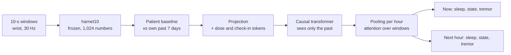
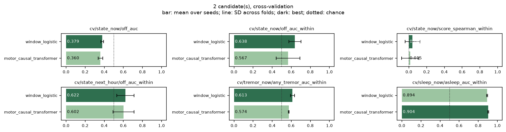
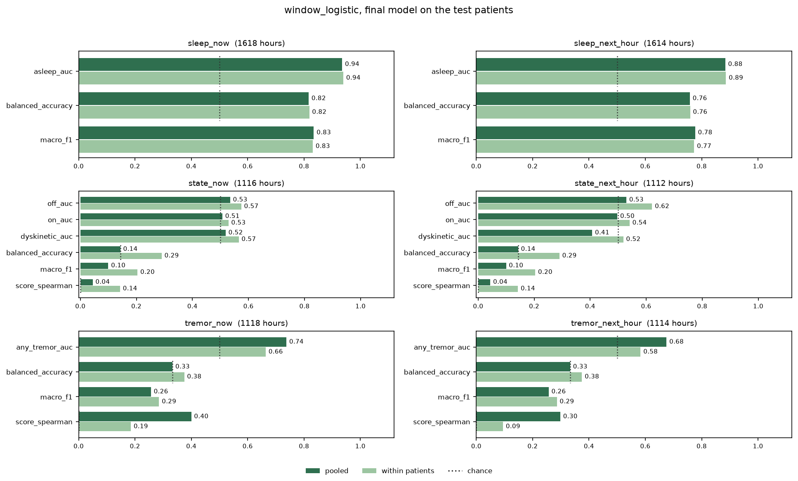
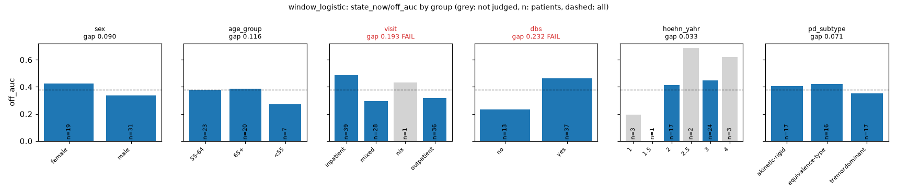
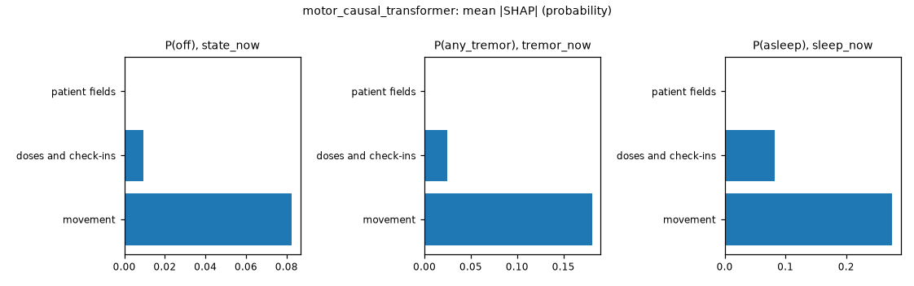

# Model Pipeline

Trains the model behind Careportal's symptom timeline. From the watch's movement, the doses and the check-ins, it estimates each hour whether the patient is asleep, their waking state (the diary's kinesia score, OFF to dyskinetic) and their tremor, now and in the next hour. It reads the data pipeline's outputs, trains and tunes with participant-grouped splits, checks for bias, and packages the chosen model as a bundle for the model registry. The model runs on the server, not the phone ([MODEL.md](../MODEL.md), "On the phone").

> **Status:** in progress.
>
> - **Built:** the contracts in `core/` (with the shared scores, `core/metrics.py`), the data loader, the patient split, three model families and the registry, training, tuning, hyperparameter sensitivity, the MLflow tracker, and selection, export, registry and the release gate (P4), and evaluate with the validation gate (P1).
> - **Built (P3):** the bias step (slices, gate, reweighing) and the explain step (Shapley values over input groups, ablation), tested on synthetic data and a small test model family.
> - **Wired (P5):** the run command goes through every step with alerts, and runs on GitHub Actions against the team's GCP project, logged to the hosted MLflow. It calls every real step in order: train, evaluate, bias, explain, select, compare, export, register.
> - **Run on the real data (2026-11-15):** the data pipeline on 60 participants through Airflow, then tuning, training, evaluate, bias, explain, select, export and register on a GCP GPU machine, logged to the hosted MLflow. See [Training on the real data](#training-on-the-real-data-2026-11-15).
> - **Still a docstring:** `models/composite.py`.
>
> Each module says what it's for and who owns it.

## The model

Every 10-second window of wrist movement goes through harnet10, a movement model pretrained on UK Biobank. harnet10 is frozen and turns each window into 1,024 numbers. Those numbers are compared with the patient's own past week, so the model sees how this hour differs from this patient's normal, not how this patient differs from others. A causal transformer then reads the windows, doses and check-ins up to now, never later, and answers for this hour and the next: asleep or awake, the diary's state (OFF to dyskinetic) and tremor.



It trains in two steps:

1. **Pretraining, no diary needed:** the transformer learns to forecast the coming movement. Any worn hour counts, so this step uses far more data than the diary has.
2. **Diary step:** the body is frozen and only the small heads learn the diary's answers. The epoch kept is the one best at telling OFF from not-OFF within each patient (`diary.select_by`).

Two simpler models are trained next to it as baselines. Both score each window on its own, with no past: `window_logistic` (logistic regression) and `window_boosting` (gradient boosting). Both get the same harnet10 features and the same patient baseline. Then the pipeline picks whichever scores best.

## Running

With Python 3.12, from `Model_Pipeline/` (the same Python as the data pipeline):

```bash
pip install torch==2.12.1 --index-url https://download.pytorch.org/whl/cpu   # or a CUDA build for a GPU
pip install -r requirements.txt
pytest -q                               # synthetic data only, nothing downloaded
python -m model_pipeline.run_model_pipeline --no-mlflow   # every step, without an MLflow server
```

The run needs the data pipeline's outputs (`dvc pull` in `../Data_Pipeline`), the patient split (`paths.split_file`, made once with `python -m model_pipeline.data.folds create`) and harnet10's weights (`MODEL_HARNET_HUB`, below).

With `train.use_tuned` on, each candidate trains with its last tuned settings (`artifacts/tuned_params.json`):

- tuned on another split or older data: reused, with a warning, and marked stale in MLflow;
- tuned before its config changed: skipped, so it trains with its config;
- never tuned: it trains with its config.

`--tune` tunes again first.

Or with only Docker: `docker compose up -d mlflow` for a local MLflow at <http://localhost:5001>, then `docker compose run --rm train` for the pipeline and `docker compose run --rm tests` for the tests.

The run command's options:

| Option | What it does |
|---|---|
| `--config <file>` | Another config instead of `config/model.yaml` |
| `--no-mlflow` | Keeps tracking in memory, so no MLflow server is needed |
| `--no-register` | Checks every gate and builds the bundle, but releases nothing. CI uses it for every run except a push to `dev` or `main`. |
| `--candidates <name> ...` | Trains only these candidates (names from `models.candidates`), for a change to one model. The release gate compares the best of them with the active version, whatever its family. Default: all |
| `--tune` | Tunes the candidates' settings again (`tune.candidates`) before training, and trains with them. Slow; without it, the last tuned settings are reused |
| `--reason <text>` | Why the run happened (a change, drift), tagged on the MLflow run |

For example, to retrain only the transformer after changing its architecture, tuning it again:

```bash
python -m model_pipeline.run_model_pipeline --candidates motor_causal_transformer --tune --reason "deeper encoder"
```

The leakage check (`train.leakage_check`) runs on one of the candidates being trained: the ones it names, or else the first candidate of the run.

### One step at a time

The Airflow DAG runs each step in its own container, with `model_pipeline/run_step.py`. `start` saves the run's choices to `artifacts/run.json` (it takes the options above) and opens the `model_pipeline` run in MLflow. Each step reads `run.json` and logs under that run, and `finish` closes it, so MLflow looks the same as after a whole run:

```bash
python -m model_pipeline.run_step start --candidates window_logistic --reason "new data"
python -m model_pipeline.run_step train          # then evaluate, bias, explain, select, compare, export, register
python -m model_pipeline.run_step finish         # or: finish --status failed
```

The steps are in `model_pipeline/pipeline_steps.py`, which both this and the whole run use. They hand over only through files in `artifacts/`:

| Step | Reads | Writes |
|---|---|---|
| tune | the data | `tuned_params.json` |
| train | the data, `tuned_params.json` | `candidates.json`, `predictions/`, `models/` |
| evaluate | `candidates.json`, `predictions/` | `candidates.json`, with the validation gate |
| bias | `candidates.json`, `predictions/`, the data | `candidates.json`, with the bias gate; `bias/` |
| explain | `candidates.json`, the data | `explain/` |
| select | `candidates.json` | `chosen.json` |
| compare | `chosen.json`, the active version's metrics | nothing: it passes or stops the run |
| export | `chosen.json`, the data | `bundle/` |
| register | `bundle/` | the registry's next version |

A step exits 1 when it stops (a failed gate, a missing input) and alerts the team, so Airflow marks it failed and skips the rest.

In a container:

- `GIT_COMMIT` names the commit MLflow records, since there's no git in the image (a build argument of the Dockerfile).
- `MODEL_MLFLOW_GOOGLE_AUTH=1` makes the tracker get Google ID tokens for the hosted MLflow from the machine's service account and renew them every 45 minutes. A token lasts an hour, and a GPU run takes hours. CI's own token is enough for its run.
- The GPU image is built with `--build-arg TORCH=cu128` and run with `--gpus all`.

The training data is the data pipeline's output, versioned by DVC. Get it with `dvc pull` in `../Data_Pipeline` (see [Training data](#training-data-dvc)). `paths.features_csv` in `config/model.yaml` points at it.

### The steps P2 built

```bash
python -m model_pipeline.data.folds create --test <ids> --rule "<how they were chosen>"   # once: the patient split
python -m model_pipeline.data.folds add [--test <new ids>]                               # when patients are added
python -m model_pipeline.steps.tune                  # tune the candidates in tune: (config/model.yaml)
python -m model_pipeline.steps.train                 # cross-validate, refit and track every candidate
python -m model_pipeline.steps.sensitivity_hparams   # which tuned settings mattered, with plots
```

Each logs to MLflow at `MLFLOW_TRACKING_URI` (else `mlflow.tracking_uri` in the config). To log to the team's server, see [Opening the hosted MLflow](#opening-the-hosted-mlflow).

Where things are, set by environment variables, not the config, because they differ per machine:

| Variable | What | Default |
|---|---|---|
| `MODEL_HARNET_HUB` | A local copy of OxWearables/ssl-wearables, with harnet10's weights (academic, non-commercial use only; never in Git or a bundle) | `~/.cache/torch/hub/OxWearables_ssl-wearables_main` |
| `MODEL_FEATURE_CACHE` | harnet10's features, computed once per patient | `artifacts/cache/harnet10` |
| `MODEL_PRETRAIN_CACHE` | The transformer's pretrained bodies, reused by fits with the same pretraining; `off` to disable | `artifacts/cache/pretrained` |
| `MODEL_DEVICE` | `cuda` or `cpu` | `cuda` when there is one |

Training works on CPU, much more slowly for the transformer. Both caches only save time: deleting them never changes a result.

## Running in the cloud

Everything runs in the GCP project `team17-mlops-neu`, region `us-central1`. It's all defined as Terraform in [`../infra/`](../infra/), so `terraform plan` there shows what exists.

| What | Where |
|---|---|
| Training data (DVC remote) | `gs://team17-mlops-neu-training-data/cops-dvc` |
| MLflow server | Cloud Run service `mlflow`, private |
| MLflow runs, parameters and metrics | Cloud SQL instance `mednova-db`, database `mlflow` |
| MLflow files: plots, reports, bundles of each run | `gs://team17-mlops-neu-models/mlflow` |
| Released bundles | `gs://team17-mlops-neu-models/parkinsons-risk/v<N>/` and `active.json`. CI sets `MODEL_REGISTRY` to the bucket; on a laptop it's `paths.registry_dir`, a local folder. `python -m model_pipeline.steps.register status` or `rollback` |
| Images | Artifact Registry `ml`: `mlflow` (the server, from `mlflow/Dockerfile`); `airflow`, `data` and `model`, which `model.yml` builds for the training VM when their folder changes; and `api`, the Backend's |

To use any of it, a teammate needs Editor on the project, and to run once:

```bash
gcloud auth login
gcloud auth application-default login     # the login DVC and MLflow's Python client use
gcloud config set project team17-mlops-neu
```

### Opening the hosted MLflow

The server only lets in signed-in Google accounts, so a browser can't open its URL directly (403). Open it through a proxy that signs each request as you:

```bash
gcloud run services proxy mlflow --region=us-central1 --port=5001
```

Then open <http://localhost:5001>, and leave the command running while you use it.

- If the local MLflow from `docker compose` is running, it already has port 5001: use `--port=5002`, or stop it with `docker compose stop mlflow`.
- The server sleeps when unused, so the first page takes about 30 seconds.
- To log runs to it from your laptop, set `MLFLOW_TRACKING_URI=http://localhost:5001` while the proxy runs.

### CI: the model workflow

[`.github/workflows/model.yml`](../.github/workflows/model.yml) trains on a VM that exists only for the run:

1. **What to run:** from `config/retrain.yaml` on a merge into `main`, or from the inputs of Actions → Model → Run workflow (which the Backend also calls on drift).
2. **The images:** the Airflow, data and model images (the model's with PyTorch's CUDA build), each tagged with its folder's git tree hash and built only when that folder changed.
3. **The VM:** made in the compute project ([`airflow/vm/create_vm.sh`](../airflow/vm/create_vm.sh)), trying machines and zones until GCP has one free: a T4 first, then an L4, in every zone GCP offers them in our four regions, us-central1 first; or an e2 machine for `compute: cpu`. The VM runs the DAG in Airflow ([`airflow/vm/startup.sh`](../airflow/vm/startup.sh)), logged to the hosted MLflow, and deletes itself when it ends.
4. **The result:** CI waits for the VM's `result.json` in GCS and passes or fails with it. The Airflow UI's link goes to the team by email, never into this public log.

CI signs in to GCP as the `training` service account through Workload Identity Federation, so there's no key file. One training run at a time, across branches: the compute project has one GPU.

**When it runs:** a merge into `main` that bumps `retrain.yaml`'s `request`; or by hand, on any branch, releasing only from `main`.

**Asking for a training run:** [`config/retrain.yaml`](config/retrain.yaml). A PR that bumps its `request` asks CI to train once it merges into `main`, with the candidates, tuning, reason and machine it names; a merge that leaves `request` alone trains nothing, so docs and fixes never train. Every PR checks the file (`python -m model_pipeline.retrain_request check`), so a typo fails the PR, not the merge. On the merge, CI reads it with `python -m model_pipeline.retrain_request conf --before <the file in the commit before>`, which prints the run only when `request` changed.

```yaml
request: 2                                  # was 1: bumped, so this merge trains
reason: "transformer: deeper encoder"
candidates: [motor_causal_transformer]      # empty: all of them
tune: true
compute: gpu                                # gpu (T4, else L4), t4, l4, or cpu (e2)
machine_type: ""                            # optional: n1-standard-16, e2-standard-16
zone: ""                                    # optional: us-central1-b
```

**Retraining on drift:** the Backend scores every patient's hours with the released model and checks prediction drift each night: the PSI of the live P(OFF) against the bundle's `stats.json` `prediction_reference` (how often the model said each P(OFF) band on its out-of-fold training hours). Over 0.25 for 3 nights in a row, with 5+ patients, it writes a report to `gs://team17-mlops-neu-training-data/drift/`. [`drift.yml`](../.github/workflows/drift.yml), hourly, opens a GitHub issue from it, "retrain in 24 h unless closed" ([`.github/scripts/drift_retrain.sh`](../.github/scripts/drift_retrain.sh)). Closing the issue rejects the retrain; one still open after 24 hours starts this workflow on `main` for the drifting model's candidate, releasing if it passes every gate. At most one drift retrain a week. Neither the Backend nor the VM holds a GitHub credential.

### CI/CD (assignment section 7)

What each requirement runs on, and where to see it:

| Requirement | How | Evidence |
|---|---|---|
| **7.1** Training starts from CI | `model.yml`: a merge that bumps `retrain.yaml`, or a run by hand, makes a GPU or CPU VM on GCP through Workload Identity Federation (no key file), which runs the model DAG in Airflow, logged to the hosted MLflow | The run of 2026-11-13 went through every step in the hosted MLflow; the VM's runs once `infra/` is applied |
| **7.2** Validation gate | `steps/evaluate.py`: a candidate fails when a metric in `validation_gate.min` is missing or below it | The real run of 2026-11-15: failed for both candidates (see [The gates](#the-gates)) |
| **7.3** Bias detection, alert or block | `steps/bias.py`: groups of 5+ patients, AUC gap over 0.15 fails; a failure emails the team, and no passing candidate stops the release | The real run: failed for both, so select stopped the run |
| **7.4** Registry push | `steps/register.py`: the bundle goes to `gs://team17-mlops-neu-models/parkinsons-risk/v<N>/`, with `active.json` naming the version in use | v1 is there, released by hand as an override after the gates failed (tagged `manual_release` in MLflow) |
| **7.5** Alerts | `run_model_pipeline.py` emails on a failed gate, a crash and finished training; `model.yml` on any other failed step; the settings are GitHub secrets | [Alerts](#alerts) |
| **7.6** Rollback | `steps/compare_production.py`: a model worse than the active one on any `release_gate.rules` metric is never exported or released; `python -m model_pipeline.steps.register rollback` makes the previous version active again | The release gate's tests, and `register status` |

### Settings

In the repo's Settings → Secrets and variables → Actions. Changing them needs repo admin.

| Name | Kind | Value |
|---|---|---|
| `GCP_PROJECT_ID` | Variable | `team17-mlops-neu` |
| `GCP_COMPUTE_PROJECT` | Variable | The project the training VMs run in (`infra/compute/`): `finetuning-499422` |
| `GCP_WIF_PROVIDER` | Variable | `projects/818790524724/locations/global/workloadIdentityPools/github/providers/mlmodel` |
| `GCP_SERVICE_ACCOUNT` | Variable | `training@team17-mlops-neu.iam.gserviceaccount.com` |
| `MLFLOW_TRACKING_URI` | Variable | `https://mlflow-pnpgeaktha-uc.a.run.app`, with no trailing slash: it's also the ID token's audience |
| `ALERT_EMAIL` | Secret | Who gets the alerts, comma-separated |
| `SMTP_HOST`, `SMTP_PORT` | Secret | `smtp.gmail.com`, `587` |
| `SMTP_USER`, `SMTP_PASSWORD` | Secret | The sending Gmail account and its app password |

The GCP values are variables, not secrets: the workflow reads them with `vars.`, and none of them grants access on its own. There's no GCP key anywhere; GCP checks GitHub's ID token instead, and only accepts it from this repo.

To send alerts from your own machine, put the five alert settings in `Model_Pipeline/.env`, which Git ignores and `docker compose` reads.

### Alerts

[`model_pipeline/alerts.py`](model_pipeline/alerts.py) emails the team. Every subject starts with `[MedNOVA model]`, and every email links to the GitHub Actions run, or names the machine for a local run.

| When | Sent by | Subject |
|---|---|---|
| A gate fails | the run command | `The production gate failed`, with the reason, such as `cv/state_now/off_auc: 0.500 vs 0.500` |
| The run crashes on an unexpected error | the run command | `Run crashed: <error>`, with the stack trace |
| Training finishes and a model is released | the run command | `parkinsons-risk v<N> released` |
| Training finishes, every gate passed, nothing released (`--no-register`) | the run command | `Training finished, every gate passed` |
| Any other CI step fails: install, GCP sign-in, image push | `model.yml` | `CI job failed` |

So every run sends exactly one email: how it finished, or why it stopped. An alert that can't be sent is logged and never fails the run. Slack works the same way with `SLACK_WEBHOOK_URL`, but the team uses email.

### Training data (DVC)

The data pipeline's output is versioned by DVC: `../Data_Pipeline/dvc.lock` in Git says which version, and the files are in the bucket. From `../Data_Pipeline`, signed in as above:

```bash
pip install "dvc[gs]"     # or the data pipeline's requirements.txt
dvc pull                  # downloads the version dvc.lock names, including data/processed/hourly_features.csv
```

To publish a new version after changing the data pipeline: `dvc repro`, `dvc push`, then commit `dvc.lock`. An Airflow run pushes by itself; the commit is always by hand. See [Data_Pipeline/README.md](../Data_Pipeline/README.md), "Making a version".

## Code structure

```text
model_pipeline/
├── core/                  contracts only, no heavy libraries
│   ├── targets.py         what is predicted: sleep, the waking state, tremor; now and next hour
│   ├── data.py            Dataset: named input groups, labels, participants, slices
│   ├── model.py           the model contract and its predictions
│   ├── metrics.py         the scores every step reports: pooled and within-patient (numpy only)
│   ├── tracker.py         the tracking contract
│   └── errors.py          one error type per kind of failure
├── models/                one module or package per model family
│   ├── window_classifier.py        window_logistic, window_boosting: each 10-s window on its own, no past
│   ├── motor_causal_transformer/   the window model: harnet10 features, attention over 8 h of past
│   ├── registry.py        family name to class; builds the config's candidates, loads saved models
│   └── composite.py       several models presented as one
├── data/
│   ├── loaders.py         the data pipeline's outputs into a Dataset
│   └── folds.py           the patient split: fixed test patients, folds over the rest
├── tracking/
│   ├── mlflow_tracker.py  MLflow; fails before training if the server can't be reached
│   └── memory_tracker.py  for tests
├── steps/                 one class per step, in the order they run
├── experiments.py         what train and tune share: cross-validation, scoring, the tuned-settings file
├── reporting/             charts (scorecard, confusion matrices, model comparison), saved and attached to runs
├── utils/                 config, logging and file helpers
├── alerts.py              email (and Slack) alerts
└── run_model_pipeline.py  runs the steps from the config
tests/                     mirrors model_pipeline/: tests/core, tests/models, ...
```

- **`core/` is what everything depends on.** It holds no MLflow, scikit-learn or deep learning code, so it stays light and portable. Change it only by team agreement.
- **Adding something is a new file, not an edit:** a model family in `models/`, a step in `steps/`, a tracker in `tracking/`.
- **Steps talk through their outputs,** never each other's internals, and raise a `core/errors.py` error when they can't go on, so the run is marked failed and an alert goes out.

## Who builds what

Letters are the components in the team plan.

| Owner | Components | Files |
|---|---|---|
| P1 | A Data loader, B Splits, F Validation + gate | `data/loaders.py`, `data/folds.py`, `steps/evaluate.py` |
| P2 | C Models + training, D Tuning, E Experiment tracking, G Sensitivity (hyperparameters) | `core/`, `models/`, `tracking/`, `experiments.py`, `reporting/`, `steps/train.py`, `steps/tune.py`, `steps/sensitivity_hparams.py` |
| P3 | H Bias detection + mitigation, G Sensitivity (SHAP, ablation) | `steps/bias.py`, `steps/explain.py` |
| P4 | I Selection after bias, J Export + bundle, K Registry + rollback | `steps/select.py`, `steps/export.py`, `steps/compare_production.py`, `steps/register.py` |
| P5 | L Docker + orchestration, M CI/CD, N Alerts, O Infrastructure | `run_model_pipeline.py`, `alerts.py`, Docker and CI files |

All paths are under `model_pipeline/`. `data/folds.py` was written by P2 as the stand-in training needed. P1 takes it over.

## Interfaces

The four hand-offs between owners. Build against these, with stand-ins for a teammate's part until it's merged. Change one only by agreement, in this file first.

> **Updated 2026-11-13 (P2), to agree with the team.** The first version described one model: a yes/no OFF score from the 7 hourly features, exported to the phone as TFLite. The model is now a window model on the server with three outputs (see [MODEL.md](../MODEL.md)), so all four hand-offs changed:
>
> - 1, 2 and 3 describe the code as it is (P1 and P3 to confirm 2);
> - 4 is a proposal, still open, marked **Open**.
>
> The 7 hourly features stay: they're the baselines' input and the drift statistics.

### 1. `load_dataset(cfg, groups)` → `Dataset` (P1 → P2, P3)

In `model_pipeline/data/loaders.py`; the `Dataset` itself is in `model_pipeline/core/data.py`.

```python
data = load_dataset(cfg, groups=("windows", "events", "patients"))
train, val = data.subset(train_ids), data.subset(val_ids)
```

Only the groups asked for are read. Every Dataset also has `hours` and `labels`:

| Part | What it holds | Who reads it |
|---|---|---|
| `hours` | One row per diary hour: `participant_id`, `hour_index`, and the bias slice columns | Everyone; P3 for the slices |
| `labels` | One column per label (see below): the class index, or NaN where there's no answer | Training, evaluate, bias |
| `features` | The 7 hourly features, one row per hour | The hourly baselines |
| `windows` | Per participant: the 10-s accelerometer windows, their start times and whether the watch was worn. Memory-mapped | The window models |
| `events` | One row per dose (LEDD, source) or check-in (the two answers) | The transformer |
| `patients` | One row per participant: more affected side, DBS | The transformer, and the no-DBS scores |

- **One clock for everything:** seconds since the participant's first diary day began. A window or event at `time_s` belongs to hour `time_s // 3600`.
- **The window cut is versioned.** `windows` in `config/model.yaml` gives the seconds, rate and axes, and a Dataset cut with another version is refused.
- **The patient split is a file** (`paths.split_file`, made with `model_pipeline/data/folds.py`), never recomputed. The test patients never change, no one ever moves into them, and the folds spread the patients with DBS and with dyskinetic hours. It names patients, so it's kept with the data, never in Git.
- **A label is a target at a horizon,** for example `state_now` or `tremor_next_hour`. The targets are in `model_pipeline/core/targets.py`:

| Target | Classes |
|---|---|
| `sleep` | 2: awake, asleep |
| `state` | 7: the waking kinesia score, −3 to +3. No label in sleep hours |
| `tremor` | 3: the tremor score, 0 to 2. No label in sleep hours |

  The broad states are sums of state classes: OFF is −3 to −1, ON is 0, dyskinetic is +1 to +3.

### 2. Predictions and scores (P2 → P1, P3)

**In code:** `Predictions` in `model_pipeline/core/model.py`, which `model.predict(data)` returns.

- `hours`: `participant_id` and `hour_index`, one row per hour of the data, in its order.
- `probs`: per label, the probability of each class per hour. Each row adds up to 1.
- `windows`: for a window model, the same probabilities for every worn 10-s window. These feed the app's timeline.
- Helpers:
  - `p_asleep("sleep_now")`: the chance the patient is asleep;
  - `p_state("state_now", "off")`: the chance of OFF if awake;
  - `expected_score(label)`: the expected diary score;
  - `frame(label)`: one label's probabilities as a table.

**On disk:** train writes one file per label, `artifacts/predictions/<label>.csv`, because each target has a different number of classes. These files hold every candidate's out-of-fold hours (and the test patients' hours, the one time they're scored). They stay local and never go to MLflow, because they're per patient-hour.

| Column | Meaning |
|---|---|
| `participant_id`, `hour_index` | Which hour. `hour_index` joins back per-hour slices such as `visit` |
| `fold` | The cross-validation fold, or `test` for the held-out participants |
| `seed` | The training seed |
| `model` | The candidate's name, as logged in MLflow |
| `worn` | Whether the hour has a worn window. An hour without one gets the training class mix, so the scores leave it out |
| `y_true` | The true class index, empty where there's no answer |
| one column per class | Its probability, named as in `core/targets.py` (`severe_akinesia`, …) |

**Scores** are in `model_pipeline/core/metrics.py`, shared by every step, and named `{split}/{label}/{metric}`, such as `cv/state_now/off_auc_within`. Every score comes **pooled** (all patients' hours together) and **within** (`_within`: each patient's own score, averaged over patients):

- AUCs: `off_auc`, `on_auc`, `dyskinetic_auc` (state), `asleep_auc` (sleep), `any_tremor_auc` (tremor), plus `off_auc_no_dbs` (patients without DBS, pooled only);
- the most likely class: `balanced_accuracy`, `macro_f1`, and per class `recall_<class>` and `precision_<class>` (pooled only);
- the diary score (state and tremor): `score_spearman` and `score_mae`.

`selection.metric` picks the model and is what tuning maximises. It's `cv/state_now/off_auc` (pooled) today. P2 proposes `off_auc_within`, which the team still needs to agree.

### 3. The model contract (P2 → P4)

Every model family subclasses `Model` in `model_pipeline/core/model.py`. The base class checks inputs, outputs and train/validation overlap, so no family can skip those checks.

- **Class attributes:**
  - `family`: its name in the config and the registry;
  - `needs`: the Dataset groups it reads, such as `("windows", "events", "patients")`;
  - `scores_windows`: True if it also scores every worn window.
- **`fit(train, val=None, sample_weight=None, seed=0)`**, which returns the model. `val` is for early stopping and must have different participants. `sample_weight` (one weight per training hour) is how bias mitigation by reweighting reaches training. An hour of weight 0 counts as if it weren't there.
- **`predict(data)`** returns Predictions (interface 2) for every hour of `data`.
- **`save(folder)` / `Family.load(folder)`:** the weights plus a `manifest.json` (family, targets, settings, how it was trained, code and library versions). A model is never overwritten, and load refuses another family's folder. `models/registry.py`'s `load(folder)` opens any family's model by its manifest.
- **`default_params()`:** the settings and their defaults. Tuning's search spaces are in the config (`tune:`), not in code.

The families:

| Family | Needs | `sample_weight` | Status |
|---|---|---|---|
| `window_logistic` | windows | yes | Built. Baseline: logistic regression on each window's harnet10 features, an hour = the mean of its windows |
| `window_boosting` | windows | yes | Built. Baseline: the same with PCA and gradient boosting |
| `motor_causal_transformer` | windows, events, patients | yes (diary step) | Built, with 5-fold CV results in MODEL.md |
| Hourly baselines (training average, logistic regression on the 7 features) | features | – | Not built |

**Adding a family:** a `Model` subclass in `models/`, one line in `models/registry.py`'s `FAMILIES`, and a candidate in the config's `models.candidates`. Train, tune and sensitivity need no changes.

There's no `to_keras()` or phone export: the model runs on the server.

### Evaluate (P1)

`model_pipeline/steps/evaluate.py` runs after train, on its `candidates.json` and predictions files, on the same hours train scores (labelled, worn, out of fold). Per candidate it adds a 95% interval for each pooled AUC by resampling patients (1,000 times, `evaluation` in the config), each question's AUC per fold and per patient (`evaluation.json`) and the ROC curves (`roc.png`), all in `artifacts/evaluation/<candidate>/`. It sets `gates_passed` to false when a metric in `validation_gate.min` is missing or below its value, so select skips that candidate.

### 4. Bundle folder (P1, P3 → P4 → CI)

`artifacts/bundle/`, written by `export.py` and copied by `register.py` into the registry as `<family>/v<N>/`. The model runs on the server:

| File | From | What it holds |
|---|---|---|
| `model/` | P4 | The folder `model.save()` wrote: `manifest.json` and `weights/` (for the transformer: `network.pt` and `training.json`, with the harnet10 fingerprint). This replaces a phone model file |
| `manifest.json` | P4 | What the Backend needs to run and check the model: family, version and `model_id` (added by `register.py`), candidate, labels, window spec version, the training run, the model folder's sha256 and the harnet10 sha256 the server must load |
| `stats.json` | P4 | The training data's statistics for drift: the 7 hourly features, and `prediction_reference`, how often the model said each 0.1-wide P(OFF) band on its out-of-fold development hours (counts only), which the Backend's nightly drift check compares the live hours with |
| `metrics.json` | P1 | The chosen candidate's `artifacts/evaluation/<name>/metrics.json`: train's `cv/` scores plus evaluate's 95% intervals (`_auc_lo`, `_auc_hi`), which the next run's release gate compares against |
| `bias.json` | P3 | Metrics per slice and the mitigation result: `artifacts/bias/bias.json` |
| `device/` | P4 | Only with `export.device.enabled` (off by default): the model in a phone format, for testing on-device scoring later. Its converter is a placeholder that fails the run |

harnet10 isn't in the bundle: its licence limits redistribution. The server loads its own pinned copy, and the model refuses one whose sha256 differs from training.

Still open:

- where the server gets harnet10;
- the Backend endpoint for a new version.

`select.py` needs only `gates_passed`; `exportable` matters only when `export.device.required` is true.

## Training, tuning and sensitivity (P2)

They share one cross-validation (`model_pipeline/experiments.py`), so a tuning trial and a training run are scored exactly the same way: each fold's training patients fit, its validation patients scored, for every seed. The test patients are loaded only when `train.score_test` is true, once, at the end of model work.

| Step | Config | What it does | Writes |
|---|---|---|---|
| `tune` | `tune:` | One Optuna study (TPE, seeded) per listed candidate. Each trial is a cross-validation scored by `selection.metric`. Studies resume after a crash, and any change to the split, data, candidate or space starts a new one. Transformer trials that change only diary settings reuse each fold's pretrained body | `artifacts/tuning/` (studies, a trials table per candidate), `artifacts/tuned_params.json` |
| `train` | `models:`, `train:` | A shuffled-label check first (a model must score near chance on shuffled labels), then every candidate cross-validated, refit on all development patients, and saved. With `use_tuned`, a tuned candidate trains with its tuned settings: reused with a warning if they were tuned on another split or data, skipped if its config changed since | `artifacts/models/`, `artifacts/predictions/`, `artifacts/candidates.json`, `artifacts/charts/` |
| `sensitivity_hparams` | (reads the studies) | Each tuned setting's importance (fANOVA), plus plots: importance, score against each setting, score per trial | `artifacts/sensitivity/<candidate>/` |

In MLflow, each step is a run with a child per candidate. train and tune go on to a child per fold (and tune per trial before that), with the scores above, fit times and each epoch's curves. For the transformer that includes pretraining's skill per target on the validation patients, so one pretraining can be compared with another. Runs carry the split's hash and a data fingerprint, so only comparable runs get compared. For a live look at the tuning studies, `optuna-dashboard sqlite:///artifacts/tuning/studies.db`.

Charts (`train.charts`): every train run with predictions gets its own, under `charts/` in its MLflow artifacts and in `artifacts/charts/<candidate>/<run>/`:

- **Scorecard:** every score for every label, pooled and within patients side by side, with what guessing would score marked.
- **Confusion matrix per label:** for each diary answer, the share of its hours the model predicted as each class.
- **Comparison** (on the `train` run): the candidates side by side on the metrics in `train.charts.compare`, with each one's spread across folds.

Each fold run gets them (`folds: false` turns that off), each candidate's run gets them for all its folds together, and the final run gets them when the test patients are scored. MLflow's own chart view still compares any logged metric across runs. A chart that fails to draw is a warning, never a failed run.

## Bias and explanations (P3)

```bash
python -m model_pipeline.steps.bias      # after evaluate: reads artifacts/candidates.json and artifacts/predictions/
python -m model_pipeline.steps.explain   # after bias: explains each final model by its input groups
```

| Step | Config | What it does | Writes |
|---|---|---|---|
| `bias` | `bias:` | Joins each predicted hour to its patient's groups (`slice_columns`, from the hours table or else the patients table) and scores every group with Fairlearn's `MetricFrame`, using `core/metrics.py`'s scores plus each question's recall, precision and false-positive rate. Each check in `bias.checks` fails when the gap between the best and worst judged group is over its `max_gap`. A group is judged only with `min_slice_rows` hours and `min_slice_participants` patients. A failing candidate alerts and is retrained with reweighing as `<name>_reweighted`, a new candidate. No candidate passing raises `GateError` | `artifacts/bias/`: `bias.json`, `bias_report.md`, `plots/`; the updated `artifacts/candidates.json` |
| `explain` | `explain:` | Exact Shapley values over each model's input groups (movement, doses and check-ins, patient fields, hourly features) for P(OFF), P(any tremor) and P(asleep), and the AUC drop when one group is left out | `artifacts/explain/<candidate>/` (`shap.json`, `shap.png`, `ablation.png`), `explain_report.md` |

- **One candidates file, passed along.** Bias reads `artifacts/candidates.json` and writes it back with each candidate's `gates["bias"]` and `gates_passed`, which is true only when every gate passed, so select skips a candidate that failed bias. Evaluate's earlier `gates_passed` is kept as `gates["validation"]` and never overwritten. A `_reweighted` candidate, which evaluate never saw, is held to the same `validation_gate.min`.
- **Nothing judged blocks.** A candidate passes only when at least one check was judged and none failed. If every group is too small to judge, the gate fails and alerts rather than passing by default, and no reweighted retrain is made, since there's nothing to reweigh.
- **Out-of-fold predictions by default** (`bias.predictions: cv`), so every development patient counts and the test patients stay unseen.
- **Reweighing fixes imbalance, not weak signal.** It weights each group's answers as if group and answer were independent (Kamiran and Calders), with weights from each fold's training patients only. It closes a gap a model learned from who is usually OFF; it can't close one where the movement shows OFF less clearly for a group. The report shows both gaps and the selection metric's change, so the trade-off is visible.
- **Leaving a group out** shuffles it (movement within each patient, hourly features within each patient), removes it (events) or swaps it with another patient's (patient fields), repeated `explain.repeats` times.

## Training on the real data (2026-11-15)

### The patients

The COPS study has 66 patients. They're split three ways, once, and the split is versioned with DVC (`Data_Pipeline/data/processed/patient_split.json`):

| Group | Patients | Used for |
|---|---|---|
| Development | 50, in 2 folds of 25 | Training, tuning and every design choice. Each fold trains on one half and is scored on the other |
| Test | 10: COPS-4, 5, 29, 38, 39, 40, 53, 58, 62, 63 | Scored once, at the end (`train.score_test`). Never used to choose anything |
| Demo | 6: COPS-6, 41, 50, 51, 52, 59 | The app's live demo only. Left out of the data pipeline entirely (`Data_Pipeline/config/pipeline.yaml` lists the other 60) |

The 10 test patients were picked to match the whole cohort on sex, PD subtype, more affected side, DBS, Hoehn & Yahr, age and years since diagnosis, and to hold about their share of every diary answer. Each has at least 50 labelled waking hours, and at least 6 of the 10 have both OFF and not-OFF hours, so OFF can be scored within them (seeded draw, seed 42). The rule is written into the split file.

The data pipeline's run on the 60 participants: 10,272 diary hours (8,344 usable), 3.2 million 10-second windows (3.08 million worn) and 2,109 doses. Its checks found 0 critical problems and 25 warnings.

### What the scores mean

Every score is an AUC: how often the model ranks a positive hour above a negative one, where 0.5 is guessing. Each is reported two ways:

- **Pooled:** all patients' hours together. This can be won by recognising patients (someone who moves little is OFF more often) without reading their state from the movement.
- **Within patients (`_within`):** each patient's hours against each other, averaged over patients. This is what the app needs: telling a patient's OFF hour from their own good hours. Selection uses it (`cv/state_now/off_auc_within`).

### What changed the scores

At first every model scored at chance on OFF within patients, about 0.52. A review of the data found the reason: patients differ from each other far more than one patient's OFF hours differ from their good hours, and the models learned the patients. Each change below was tested on fold 1, on development patients only:

| Change | OFF within patients | Kept? |
|---|---|---|
| **Compare each patient with their own past 7 days** (`baseline: {mode: rolling}`) | logistic 0.579 → **0.640**, boosting 0.562 → **0.601**, transformer 0.522 → **0.636** | Yes, for all three models |
| The same over the past 3 days | logistic 0.632 | No: 7 days is better |
| **Keep the transformer's epoch best at OFF** (`diary.select_by: off_auc_within`) | Before, it kept a later epoch with OFF at 0.56 because the other targets improved | Yes |
| **Frozen body in the diary step** (only the heads learn) | **0.642**, against 0.58 to 0.61 when the whole network learns, which memorised the training patients | Yes |
| Adding time of day | 0.625 → 0.649 for a simple model, but time of day alone scores 0.639: the clock does the work, not the movement | No |
| Adding tremor-band frequency features | 0.625 → 0.624 | No: harnet10 already holds it |
| Adding the data pipeline's 7 hourly movement features | 0.625 → 0.636 on all patients, 0.630 → 0.628 on patients with 5+ hours of each answer | No: within noise |

How the baseline works (`model_pipeline/models/patient_baseline.py`): for each hour, the mean and spread of the patient's worn windows over the past 168 hours, never including that hour. Early on, when a patient has little past, it's pulled toward the training patients' mean and spread, as if the patient already had 24 hours of average data (`warmup_h`), so the pull fades as their own hours add up. It only ever looks back, so it works the same way on live data from the app. The training patients' mean and spread are saved with the model.

### The gates

| Gate | When it fails | Setting, and why |
|---|---|---|
| **Leakage check** (train) | A model fitted to shuffled labels scores far from 0.5 | `max_auc: 0.6`, judged on state and tremor, within patients only. Sleep isn't judged, because it follows the night even with shuffled labels. Pooled AUCs aren't judged, because they follow how much each patient moves (0.36 on shuffled labels with no leak). A leak would still show within patients |
| **Validation gate** (evaluate) | OFF or tremor scores below guessing | `cv/state_now/off_auc` and `cv/tremor_now/any_tremor_auc` at least 0.5 |
| **Bias gate** (bias) | A patient group scores much worse than another | AUC gap over 0.15 on OFF, any tremor or asleep, between groups of 5 or more patients. Groups of 2 to 4 measure those people more than the group, so they're reported but not judged |
| **Release gate** (compare) | The chosen model is worse than the one in production | Compares its scores with the production model's `metrics.json` |

### Where it ran

The full run needs a GPU for harnet10 and the transformer, so it ran on a GCP machine with one NVIDIA L4 (`g2-standard-8`):

1. The data pipeline ran in Airflow (Dhruv's `cops_data_pipeline` DAG, in Docker on the same machine) for the 60 participants, and pushed the data version and the patient split to the team's DVC remote.
2. `python -m model_pipeline.steps.tune`: 3 Optuna trials each for logistic regression and boosting. Each trial is a full 2-fold cross-validation.
3. `python -m model_pipeline.run_model_pipeline`: train, evaluate, bias, explain, select, export and register, with the tuned settings.
4. `python -m model_pipeline.steps.sensitivity_hparams`: which tuned settings mattered.

Every step logged to the team's hosted MLflow in the experiment `parkinsons-risk`, through `gcloud run services proxy` on the machine. The run's logs are attached to a `run_logs` run. When everything finished, `artifacts/` (without the caches), the config, the split and the logs were copied to a bucket, and the machine shut itself down.

### Results

The run that produced these (2026-11-15) trained logistic regression and the transformer. Boosting was left out to save time, after its leakage check passed. Everything is in MLflow (experiment `parkinsons-risk`), and the charts below are copied from there into [`docs/results/`](docs/results/).

| | OFF within patients | OFF next hour, within | Tremor (any), pooled | Asleep | OFF pooled |
|---|---|---|---|---|---|
| **Logistic**, development patients (2-fold CV) | **0.638** | 0.622 | 0.670 | 0.899 | 0.379 |
| **Logistic**, the 10 test patients | 0.574 | 0.621 | 0.738 | 0.935 | 0.535 |
| Transformer, development patients (2-fold CV) | 0.567 | 0.602 | 0.665 | 0.906 | 0.360 |
| Transformer, the 10 test patients | 0.503 | 0.604 | 0.740 | 0.950 | 0.566 |

All AUCs; 0.5 is guessing.

- **Sleep is easy, tremor works, OFF is hard.** Asleep scores 0.90–0.95 and any tremor 0.67–0.74. OFF within patients is above guessing but modest: 0.64 on the development patients and 0.57 on the test patients for logistic.
- **Logistic beat the transformer** on the selection metric (0.638 against 0.567). The transformer's two folds disagreed: 0.685 on fold 1 but 0.435 on fold 2.
- **The pooled OFF AUC is below 0.5** for both. Comparing each patient with their own past removes how much each patient moves, which pooled AUC otherwise rewards. Patients who move less are OFF more often, so pooled hours rank backwards. Within patients, where the app works, it's above 0.5.





The transformer's test scorecard: [`transformer_scorecard_test.png`](docs/results/transformer_scorecard_test.png). The ROC curves, with 95% intervals from resampling patients: [`logistic_roc.png`](docs/results/logistic_roc.png).

**The gates:**

| Gate | Result |
|---|---|
| Leakage check | **Passed:** boosting on shuffled labels stayed within 0.40–0.60 within patients |
| Validation | **Failed** for both: pooled OFF AUC 0.379 and 0.360, under 0.5 (see above) |
| Bias | **Failed** for both (details below) |
| Release | No candidate passed, so select stopped the run. Logistic was then released by hand as version 1 of `parkinsons-risk`, with the best within-patient OFF AUC. That run is `manual_release` in MLflow, tagged as an override with both gate failures. The bundle is in the team's registry, `gs://team17-mlops-neu-models/parkinsons-risk/v1/`, and `active.json` names it, so `python -m model_pipeline.steps.register status` and `rollback` work on it |

The validation gate judges pooled AUC, which the patient baseline pushes below 0.5, while selection and the leakage check judge within patients.

**Bias.** Each group's OFF AUC is pooled within that group, so most sit below 0.5 for the reason above. The gaps between groups are still real:

- **DBS:** OFF scored 0.23 for patients without DBS against 0.47 with (logistic), a gap of 0.23 against the 0.15 allowed.
- **Visit type:** mixed visits 0.30 against inpatients 0.49.
- **Hoehn & Yahr:** any tremor scored 0.60 at stage 2 against 0.77 at stage 3.

**Mitigation:** the bias step retrains a failing candidate with reweighing (`bias.mitigation`, see [Bias and explanations](#bias-and-explanations-p3)). It weights each group's answers as if group and answer were independent, using each fold's training patients only, and reports the gap and selection score before and after. It was switched off for this run (`mitigation.enabled: false`) to fit the time. Reweighing closes a gap that comes from imbalance. It can't close one where OFF shows less clearly in the movement, which may be the case without DBS. The full tables are in `artifacts/bias/bias_report.md`.



Tremor per group: [`logistic_bias_tremor.png`](docs/results/logistic_bias_tremor.png).

**What the transformer relies on.** Movement carries most of every answer. Doses and check-ins add a little to OFF and tremor and more to sleep, and the patient fields add nothing. Logistic regression reads movement only, so its chart has one bar.



**Tuning.** 3 trials each for logistic regression and boosting. For logistic regression, how strongly rare answers are weighted (`class_weight_power`, importance 0.62) mattered more than the regularisation strength (`c`, 0.38). With only 3 trials, that's a rough guide: [`logistic_sensitivity.png`](docs/results/logistic_sensitivity.png).

## Adding your step

- Fill in your module in the structure above, and put its settings in `config/model.yaml` under your own section. No hard-coded values.
- Test it in the matching folder, e.g. `tests/steps/test_bias.py` for `model_pipeline/steps/bias.py`, with `tests/helpers.py`: `make_config(tmp_path)` gives a config, `make_features_table()` a synthetic hourly table with the real file's columns, and `make_dataset(spec)` a small synthetic Dataset with windows, events and patients. Tests never read the real data.
- Add libraries under your heading in `requirements.txt`, pinned to an exact version.
- Don't import from `../Data_Pipeline`. Both folders have a package named `scripts`, so copy what you need, as `model_pipeline/utils/` and `model_pipeline/alerts.py` were.
- Everything a run writes goes in `artifacts/`, which Git ignores. Models and data never go in Git.
